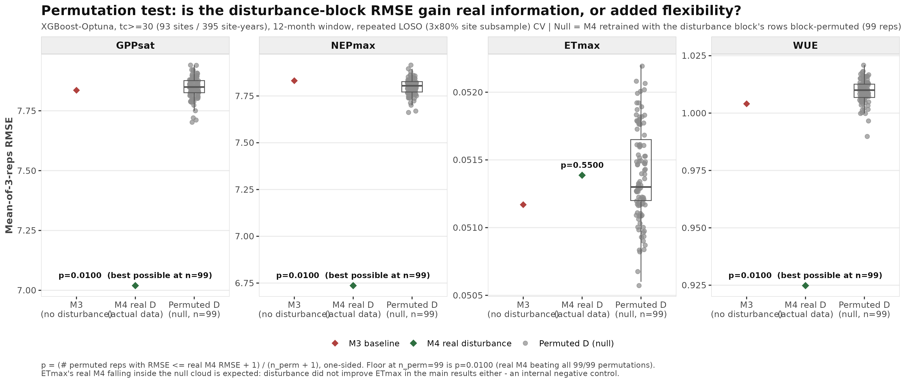
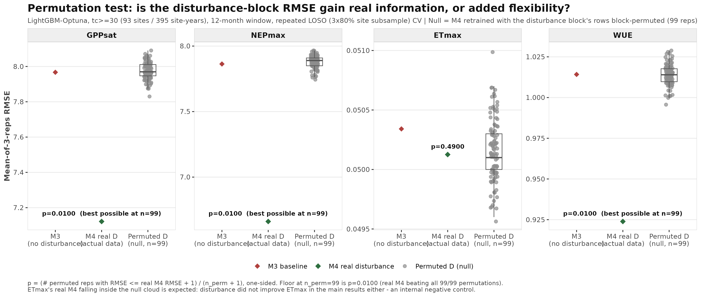
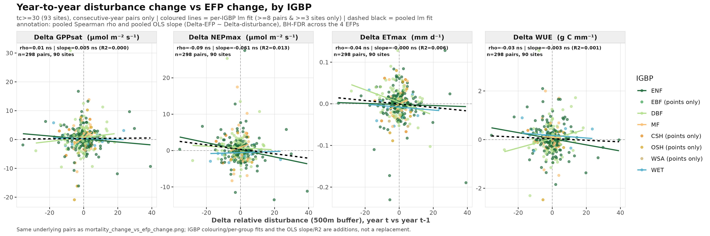
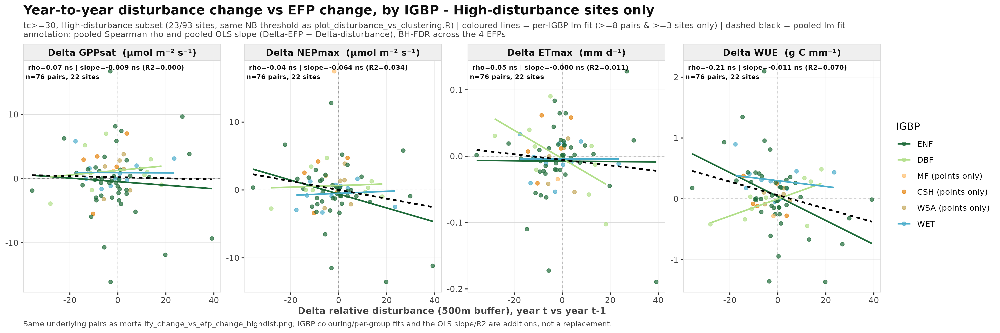
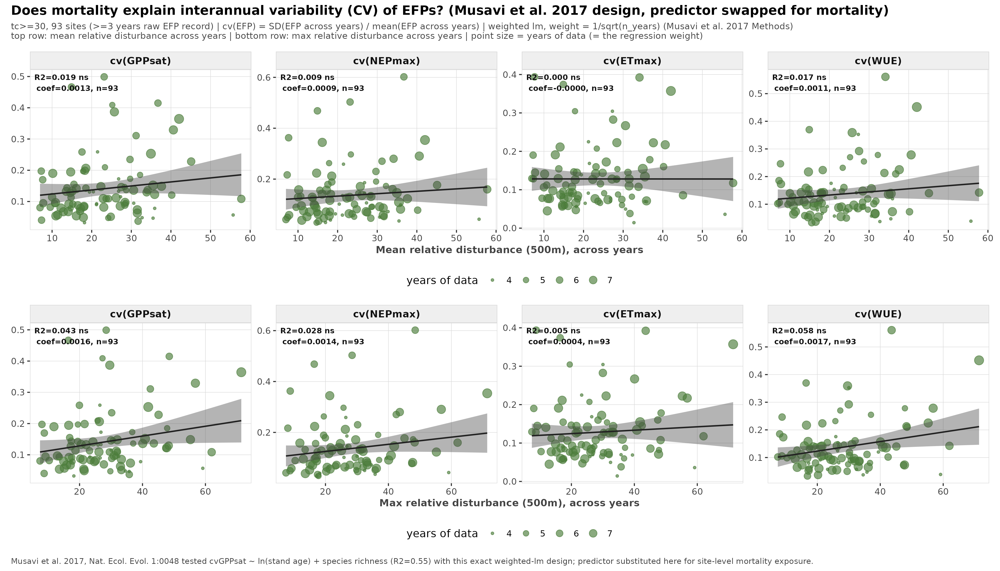
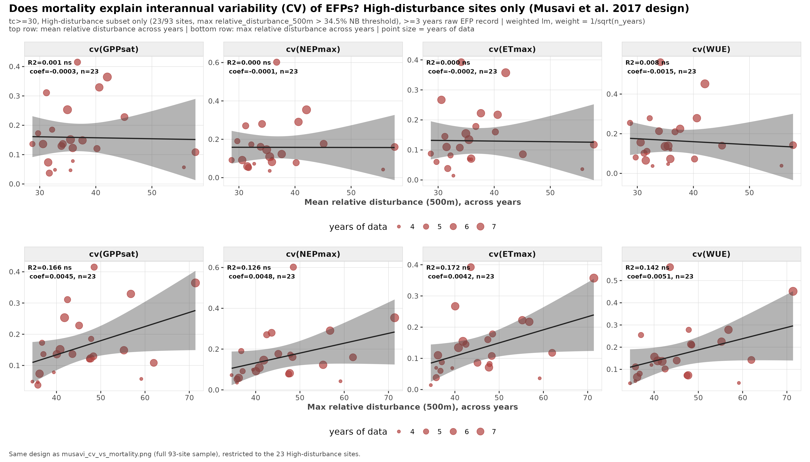

# FORTRACK meeting follow-up — permutation test, simple mortality↔EFP tests, Musavi CV test

**Date:** 2026-09-16
**Question addressed:** three action items from the 2026-09-14 FORTRACK meeting (see `meeting's note/2026-09-14-fortrack-monthly-meeting.md`) —
René's point #6 (is the disturbance-block RMSE gain real information or just added model flexibility?),
Miguel's point #4 (is there a simple, non-ML relationship between changes in mortality and changes in EFPs?),
and a follow-up replicating Musavi et al. 2017's stability-analysis design with mortality as the predictor.

All tests use the tc≥30 dataset (93 sites / 395 site-years), the standing scope for this project. Nothing here changes any previously reported model result — these are additional, complementary analyses.

---

## 1. Permutation test — does disturbance help because it's real information, or just extra columns? (René, #6)

**Concern raised:** M4 (climate+traits+disturbance) has ~100 more predictors than M3 (climate+traits only), so its lower RMSE could in principle come from added flexibility rather than the disturbance information itself.

**Design:** shuffle which site-year's disturbance vector is attached to which site-year's response/climate/traits (breaking the link to the outcome while preserving the disturbance block's own internal structure), retrain M4 on the shuffled data under identical CV folds and hyperparameters, repeat 99 times per EFP. If real M4 is not unusually good compared to this null distribution, the RMSE gain is indistinguishable from adding 100 random columns. Tested for both learners (XGBoost-Optuna, LightGBM-Optuna) and two CV schemes (plain LOSO, and repeated LOSO with 3×80% site subsampling).

**Result — real M4 beats every single permutation for GPPsat, NEPmax, and WUE, across all four learner×CV combinations:**

| Learner | CV | GPPsat | NEPmax | ETmax | WUE |
|---|---|---:|---:|---:|---:|
| XGBoost | LOSO | p=0.01 | p=0.01 | p=0.16 | p=0.01 |
| XGBoost | repeated (3×80%) | p=0.01 | p=0.01 | p=0.55 | p=0.01 |
| LightGBM | repeated (3×80%) | p=0.01 | p=0.01 | p=0.49 | p=0.01 |

p = 0.01 is the floor at 99 permutations (real M4 beat all 99/99 nulls) — the result can't get any tighter without more reps. ETmax stays non-significant in every configuration, which is expected (disturbance never improved ETmax in the main results either) and works as a built-in negative control: the test correctly does *not* manufacture a false positive where there's genuinely nothing to find.

*Grey dots = 99 permuted-D null models; green diamond = real M4; red diamond = M3 baseline. For GPPsat/NEPmax/WUE, the null cloud clusters tightly around the M3 baseline while real M4 sits far below (better RMSE) — the permuted disturbance carries no information, so those models revert to the no-disturbance baseline. For ETmax, real M4 sits inside the null cloud — indistinguishable from noise, matching the main result.*

*Same pattern under a second learner — ETmax's null is even cleaner here (p=0.49).*

**Takeaway for the manuscript:** the RMSE improvement from disturbance is robust across two learners and two CV schemes, and is not an artifact of model flexibility. This is strong, citable (p<0.05, in fact p=0.01) support for René's requested robustness check.

---

## 2. Simple pairwise test — do year-to-year changes in mortality track year-to-year changes in EFPs? (Miguel, #4)

**Concern/suggestion raised:** the ML models are complex; Miguel asked whether a much simpler, direct relationship exists — pairwise differences between consecutive years within a site.

**Design:** for each site, take first differences between *consecutive available years only* (year *t* − year *t*-1 = 1, so every pair reflects exactly one calendar year of change — pairs spanning a gap are dropped). Δdisturbance = `relative_disturbance_500m(t) − relative_disturbance_500m(t-1)`; ΔEFP = raw EFP value differenced the same way. Pooled Spearman correlation (+ BH-FDR across the 4 EFPs), plus a formal OLS regression (slope, R², P) to test whether ΔEFP is literally a linear function of Δmortality — not just rank-correlated with it.

### 2a. Full sample (93 sites → 298 consecutive-year pairs from 90 sites)

| EFP | Spearman ρ | q | OLS slope | R² | q(slope) |
|---|---:|---:|---:|---:|---:|
| GPPsat | 0.01 | 0.89 | 0.005 | 0.000 | 0.90 |
| NEPmax | -0.09 | 0.53 | -0.061 | 0.013 | 0.19 |
| ETmax | -0.04 | 0.75 | -0.0004 | 0.006 | 0.33 |
| WUE | -0.03 | 0.75 | -0.003 | 0.001 | 0.69 |

**Null across the board** — no detectable relationship, by either a rank-based or a linear-functional test.

*Each point is one consecutive-year pair, coloured by IGBP biome. Coloured lines = per-IGBP linear fit (only for biomes with ≥8 pairs from ≥3 sites: ENF, DBF, MF, WET); dashed black = pooled fit. The pooled fit is flat, but individual biomes visibly diverge — e.g. ENF trends slightly negative for WUE while DBF trends positive — though no biome has enough data to test this split formally.*

### 2b. High-disturbance sites only (23/93 sites → 76 pairs from 22 sites)

Restricting to the sites classified "High disturbance" (site's maximum relative_disturbance_500m across years exceeds the natural-breaks threshold of 34.5%, the same site set used in the earlier clustering analysis) — testing René's meeting point #5, that the signal might be diluted by low/no-disturbance sites.

| EFP | Spearman ρ | q |
|---|---:|---:|
| GPPsat | 0.07 | 0.71 |
| NEPmax | -0.04 | 0.71 |
| ETmax | 0.05 | 0.71 |
| WUE | -0.21 | 0.29 |

**Still null**, though WUE has the largest magnitude of any pairwise test in either sample (ρ=-0.21) — likely underpowered at n=76 rather than truly zero.

*Same design, 23 High-disturbance sites only. ENF (dark green) shows the clearest negative WUE trend; DBF trends positive.*

**Takeaway for the manuscript:** the raw pairwise relationship — the literal "simple test" Miguel asked for — does not show a detectable signal, even restricted to the most disturbed sites. This is not a problem for the paper; it directly validates Teja's caveat from the same meeting (a same-year climate swing can drive both axes at once, and this simple test can't separate that out) and reinforces why the ML approach, which conditions on climate, is the right tool to detect the effect that the permutation test above confirms is real.

---

## 3. Musavi et al. 2017-style test — does mortality explain interannual *variability* of EFPs?

Musavi et al. 2017 (*Nat. Ecol. Evol.* 1:0048, "Stand age and species richness dampen interannual variation of ecosystem-level photosynthetic capacity") is the paper this project's EFP framework builds on (their GPPsat definition — 90th percentile of daily GPP at saturating light — is used here unchanged). Their central test: compute cvGPPsat = SD(GPPsat across years) / mean(GPPsat across years) per site, then fit a linear model against stand age and species richness, weighting each site by 1/√(n years) to down-weight short records. We replicated this design exactly, substituting their predictors for site-level mortality exposure (mean and max `relative_disturbance_500m` across years), across all four EFPs. This asks a different question than section 2: not whether mortality shifts the *level* of an EFP, but whether it explains how *variable* an EFP is from year to year.

### 3a. Full sample (93 sites, all with ≥4 years raw EFP record)

| EFP | predictor | R² | P | q |
|---|---|---:|---:|---:|
| GPPsat | max disturbance | 0.043 | 0.047 | 0.094 |
| WUE | max disturbance | 0.058 | 0.021 | 0.082 |
| NEPmax | max disturbance | 0.028 | 0.106 | 0.141 |
| ETmax | max disturbance | 0.005 | 0.503 | 0.503 |
| *(mean disturbance, all EFPs)* | | 0.000–0.019 | 0.18–0.99 | 0.44–0.99 |

Weak positive associations for the max-disturbance predictor — nominally significant before FDR correction (GPPsat, WUE), marginal after (q≈0.08–0.09). Direction is sensible: more peak disturbance → more interannual instability.

*Top row: mean disturbance across years; bottom row: max disturbance across years. Point size = years of data (also the regression weight). The bottom-right panels (GPPsat, WUE vs max disturbance) show the clearest upward trends.*

### 3b. High-disturbance sites only (23/93 sites)

| EFP | predictor | R² | P | q |
|---|---|---:|---:|---:|
| ETmax | max disturbance | 0.172 | 0.049 | 0.096 |
| GPPsat | max disturbance | 0.166 | 0.053 | 0.096 |
| WUE | max disturbance | 0.142 | 0.077 | 0.096 |
| NEPmax | max disturbance | 0.126 | 0.096 | 0.096 |

**R² roughly triples for every EFP** compared to the full sample once restricted to already-disturbed sites. Still doesn't clear q<0.05 (n=23 is small, and BH correction pools the four similar p-values to a common q=0.096), but this is the clearest, most consistent directional signal found across this entire family of simple tests.

*Same design, 23 High-disturbance sites. Every panel in the bottom row (max disturbance) now shows a visually clear upward trend.*

**Takeaway for the manuscript:** unlike the raw pairwise-change test, this variability-based framing (directly modelled on the paper the EFP concept itself comes from) shows a consistent, directionally-sensible — if modest and not FDR-significant — pattern: among already-disturbed sites, more intense disturbance associates with more year-to-year instability in ecosystem function. Worth mentioning as a complementary, literature-grounded observation, with the caveat that it doesn't survive multiple-testing correction on its own.

---

## Summary across all tests

| Test | Question | Result |
|---|---|---|
| Permutation test (§1) | Is the RMSE gain real info or just flexibility? | **Real** — p=0.01 for GPPsat/NEPmax/WUE, robust across 2 learners × 2 CV schemes |
| Pairwise Δmortality vs ΔEFP, full sample (§2a) | Simple raw relationship? | Null |
| Pairwise Δmortality vs ΔEFP, high-disturbance (§2b) | Same, restricted to disturbed sites | Still null (WUE ρ=-0.21 largest, ns) |
| Musavi cv(EFP) ~ mortality, full sample (§3a) | Does mortality explain EFP *instability*? | Weak positive, marginal (q≈0.08–0.09) |
| Musavi cv(EFP) ~ mortality, high-disturbance (§3b) | Same, restricted to disturbed sites | Strongest signal found (R²=0.13–0.17), still q=0.096 |

**Overall narrative:** the ML-based result (disturbance improves EFP prediction) is now backed by a strong, FDR-significant permutation test. The simple, non-ML relationships Miguel and the group discussed are largely null in their most literal form (raw pairwise change), but a variability-based framing modelled on Musavi et al. 2017 shows a modest, consistent, directionally-correct signal — strongest exactly where the meeting's point #5 predicted it should be (the strongly disturbed sites), even though it doesn't reach formal significance at this sample size. This is consistent with, not contradictory to, the main finding: mortality's effect on ecosystem functioning is real but concentrated in a minority of strongly disturbed sites, and only detectable once climate variability is properly conditioned on (as the ML models do) or once the sample is restricted to where the effect should be strongest.

---

## Provenance

- Permutation test: `scripts/permutation_test_disturbance.R`, `scripts/plot_permutation_test_disturbance.R` → `plots/V10/disturbance_split/permutation_test_disturbance_12m*.csv/png/pdf`
- Pairwise diff tests: `scripts/plot_mortality_change_vs_efp_change*.R` → `plots/V10/mortality_change_vs_efp_change/`
- Musavi CV tests: `scripts/plot_musavi_cv_vs_mortality*.R` → `plots/V10/mortality_change_vs_efp_change/musavi_cv_*`
- Reference paper: Musavi et al. 2017, *Nat. Ecol. Evol.* 1:0048, DOI 10.1038/s41559-016-0048 (`plots/V10/mortality_change_vs_efp_change/musavi2017.pdf`, not tracked in git — copyright)
- Meeting notes: `meeting's note/2026-09-14-fortrack-monthly-meeting.md` (not yet committed — awaiting your decision, names coauthors)
- Site scope throughout: tc≥30, 93 sites / 395 site-years (standing constraint, unchanged)
